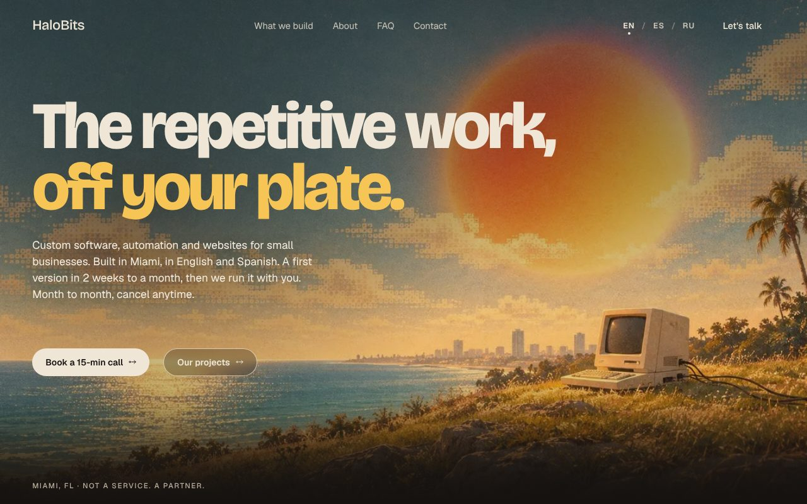

# HaloBits

**Live: [halobits.com](https://halobits.com)**

[](https://github.com/elperroloc0/HaloBits.com/actions/workflows/ci.yml)



Marketing site for HaloBits, a Miami studio that builds websites, automation and
custom software for small businesses. Static site built with [Astro 5](https://astro.build), in English,
Spanish and Russian, deployed on Vercel.

> New to the stack? Read **[LEARNING.md](LEARNING.md)**, a from-scratch guide to
> everything in this repo (Astro, CSS, components, SEO, deploy).

## Highlights

- **Three languages** with Astro i18n routing: English at `/`, Spanish at `/es/`,
  Russian at `/ru/`. The nav's language switcher links each page to its twin,
  and every page emits `hreflang` alternates for search engines.
- **No client framework.** Pages are plain HTML + scoped CSS, with a few small
  inline scripts for progressive enhancement (mobile menu, contact form).
- **SEO basics built in:** sitemap, per-language Open Graph images, canonical
  URLs, and preview deployments that are automatically `noindex`.
- **Contact form** posts to [Formspree](https://formspree.io) and falls back to
  a pre-filled email if the endpoint is unset.
- **Release gate:** `scripts/check-build.mjs` scans `dist/` for local paths, dev
  hosts and unresolved owner placeholders before anything ships.

## Develop

Requires Node 20+ (see `.nvmrc`).

```bash
npm install
npm run dev      # → http://localhost:4321
```

## Scripts

| Command                 | What it does                                                                |
| ----------------------- | --------------------------------------------------------------------------- |
| `npm run dev`           | Start the dev server with hot reload.                                       |
| `npm run build`         | Build the static site into `dist/` (+ sitemap), then run the release check. |
| `npm run preview`       | Serve the built `dist/` locally, as production would.                       |
| `npm run check`         | Type-check `.astro`/TS files with `astro check`.                            |
| `npm run check:release` | Strict release check: any finding in `dist/` fails.                         |
| `npm run test:e2e`      | Playwright smoke tests against the built site (build first).                |
| `npm run format`        | Format the codebase with Prettier.                                          |

## CI

GitHub Actions ([`.github/workflows/ci.yml`](.github/workflows/ci.yml)) runs on
every pull request and on pushes to `main`: `astro check`, the production build,
the strict release check, and a Playwright smoke test of the language switcher.

## Configuration

All optional, set as environment variables in Vercel:

| Variable                   | Default                          | Purpose                                                                         |
| -------------------------- | -------------------------------- | ------------------------------------------------------------------------------- |
| `PUBLIC_CONTACT_ENDPOINT`  | the site's Formspree form        | Where the contact form POSTs. Empty → `mailto:`.                                |
| `PUBLIC_BOOKING_URL`       | `https://cal.com/halobits/15min` | "Book a call" link. Empty → the contact page.                                   |
| `PUBLIC_GSC_VERIFICATION`  | the current Search Console token | Google Search Console verification meta tag.                                    |
| `PUBLIC_SHOW_PLACEHOLDERS` | unset                            | `true` shows placeholder blocks in a build (they always show in `npm run dev`). |

## Deploy

Auto-deploys to Vercel on push to `main` (`vercel.json` sets the build command
and output). Domain, DNS, Search Console and email setup are in
[docs/LAUNCH.md](docs/LAUNCH.md).

## Products live on subdomains

- **concierge.halobits.com** is a bilingual AI receptionist (separate repo).

Each product keeps its own repo and subdomain; this site is the brand/SEO layer
that links out to them. The previous blue design is kept in git as tag
`old-site-v1`.
